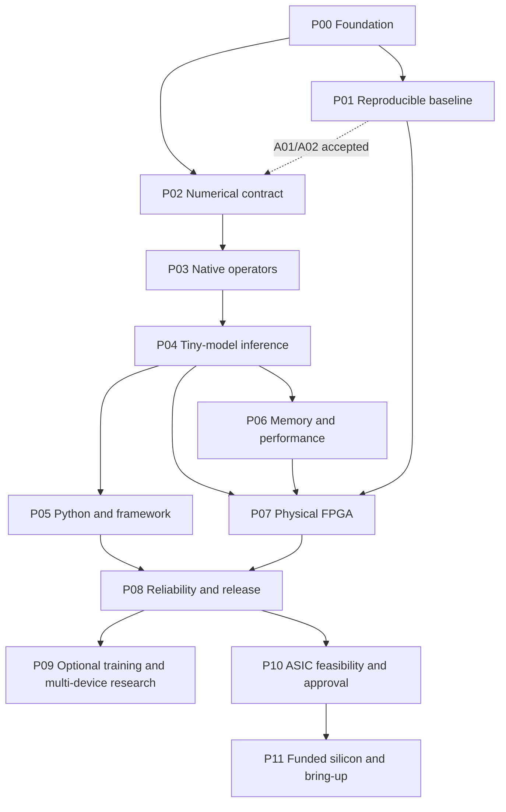

# AI-GPU development roadmap

**The goal is a programmable AI accelerator, built on Vortex, with a path from
correct calculations to a useful model, a real FPGA prototype and potentially
custom silicon.** “NVIDIA-style” describes that architectural ambition; it does
not promise NVIDIA performance, CUDA compatibility or a finished commercial GPU.

This page explains the route. [Current status](docs/project/status.md) says where
work actually stands. [roadmap.json](docs/project/roadmap.json) is authoritative
for dependencies, owners' roles, the **36 acceptance criteria across 12 phases**,
completion state and evidence references. A plan is not a test result.

## The route in plain language

1. **Prove the existing building blocks.** Reproduce the inherited GPU and tensor
   calculations on one small, pinned configuration before changing their behavior.
2. **Give AI programs usable building blocks.** Turn native matrix multiplication
   and related kernels into a tested operator library, then run one complete tiny
   model. Inference means using a model to produce an answer; training is separate.
3. **Make that model accessible and efficient.** Add a thin Python/framework
   bridge and improve measured memory or execution bottlenecks. These two branches
   can proceed independently after native model execution is accepted.
4. **Prove it on a physical board.** An FPGA is reconfigurable hardware on which
   the GPU design can be tested with real external memory and host transfers.
   Qualify that prototype before calling it a reliable experimental release.
5. **Decide whether to manufacture a chip.** An ASIC is a custom manufactured
   chip. It requires qualified physical design, memory/interface IP, packaging,
   specialist ownership, funding and explicit human approval—not just more code.

The first product-shaped milestone is **one fixed tiny model executed through
the native Vortex runtime, with correct outputs and traces proving where its work
ran**. A replacement HIP compiler is not required for this first milestone.
See the [charter](docs/project/charter.md), [inherited baseline](docs/project/baseline.md)
and [architecture](docs/project/architecture.md) for scope and existing foundations.

## Dependencies, not a calendar promise

Solid arrows mean full phase completion is required **for downstream closure**.
Preparatory work can precede closure. The dotted P01-to-P02
arrow is narrower: only **accepted P01-A01 and P01-A02 evidence** is needed to
start P02. P01-A03 stays blocked and is required to complete P01 before P07
can be accepted;
this staging decision does not waive integration proof or later exit gates.

**P09 is not a prerequisite for P10/P11.** A bounded inference chip need not wait
for training or multiple-device research. Python is also not required for P07's
native FPGA demonstration, but P08 combines the Python and physical-board paths.
No tapeout date, board purchase, memory capacity, clock or performance target is
approved by this roadmap; those decisions need evidence and accountable owners.

## Phases and observable exits

Each linked phase guide contains entry conditions, ordered work packages,
deliverables, acceptance IDs `Pxx-A01`–`Pxx-A03`, stop conditions and handoff.
The summaries below do not replace the exact criteria in the canonical manifest.

| Phase | What we build or establish | Requires | What closes the phase |
|---|---|---|---|
| [P00 — Project foundation](docs/project/phases/p00-foundation.md) | A clear, resumable development contract | None | Complete navigation and preserved image; passing offline validation/tests; resolved independent review and verified publication |
| [P01 — Reproducible baseline](docs/project/phases/p01-baseline.md) | Proof that the chosen inherited configuration builds and runs | P00 | Pinned clean build; native FP16/BF16 GEMM and supported attention reference checks; full XRT hardware-emulation integration evidence (still blocked) |
| [P02 — Tensor numerical contract](docs/project/phases/p02-tensor.md) | Defined arithmetic and supported formats | P00 plus accepted P01-A01/A02 | Reviewed numerical rules; native edge/layout tests; WGMMA synchronization/backpressure and applicable parity evidence |
| [P03 — AI operator library](docs/project/phases/p03-operators.md) | Reusable native AI operations and safe runtime wrappers | P02 | Versioned operator/support manifest; independent reference checks with dispatch traces; buffer/lifetime/error tests |
| [P04 — Tiny-model inference](docs/project/phases/p04-inference.md) | One complete fixed model on the native path | P03 | Reproducible licensed fixture; matching intermediate/final outputs; traced device work and separately reported host work/transfers |
| [P05 — Python and framework integration](docs/project/phases/p05-framework.md) | A thin Python binding and scoped PyTorch custom operators | P04 | Binding/lifetime/install tests; model agreement and device dispatch; tested-version/operator compatibility matrix |
| [P06 — Memory and performance scaling](docs/project/phases/p06-performance.md) | Evidence-led optimization of useful work and data movement | P04 | Frozen benchmark records; correctness-preserving before/after results and applicable gates; explicit resource/timing budgets |
| [P07 — Physical FPGA prototype](docs/project/phases/p07-fpga.md) | One real board running the native model with real DRAM and host transfers | P01, P04, P06 | Recorded target/bitstream/achieved clock; physical DMA/memory/compute/model tests; one-hour initial soak without unexplained errors |
| [P08 — Reliability and release hardening](docs/project/phases/p08-reliability.md) | A reproducible, bounded experimental release | P05, P07 | Physical fault/recovery/isolation tests; 24-hour physical soak; reviewed reproducible artifacts, licenses and compatibility evidence |
| [P09 — Training and multi-device research](docs/project/phases/p09-research.md) | Separately qualified training and two-device operation | P08; explicitly activated research scope | Physical gradient/convergence proof; collective ordering/failure/recovery tests; measured communication and scaling costs |
| [P10 — ASIC feasibility and sign-off planning](docs/project/phases/p10-asic.md) | An evidence-backed decision on a bounded inference chip | P08 | Qualified PDK/macros/interface IP/package/tool availability; complete sign-off plans; human-approved scope, budget, ownership and partners |
| [P11 — Funded silicon realization and bring-up](docs/project/phases/p11-silicon.md) | Authorized fabrication and measured packaged silicon | P10 | Qualified manufacturing sign-off; actual board/silicon bring-up; frozen-model execution and honest measured operating limits |

## What counts as progress

Use the [acceptance policy](docs/project/acceptance.md) and
[evidence format](docs/project/evidence/README.md). Source inspection,
simulation, native RTL verification, physical FPGA measurements and silicon
measurements are different kinds of proof. Report the exact revision,
configuration, backend, commands, results, artifact hashes and limitations.

- A DPI arithmetic simulation cannot prove the native tensor datapath.
- Processor-only `rtlsim` cannot replace full AFU integration; `hw_emu` cannot
  replace a physical FPGA run. Missing vendor integration remains blocked under
  P01-A03 and bars P07, but no longer bars the evidenced P02 software track.
- A custom-op bridge does not establish a complete PyTorch device backend,
  autograd, arbitrary model support or CUDA binary compatibility.
- More cores, a named commercial-GPU simulation profile or theoretical peak
  arithmetic do not establish faster real applications or market equivalence.
- Real memory requires a supported physical controller/PHY, wiring and package
  integration. Changing a simulated memory-size setting does not supply DRAM/HBM.
- Synthesis estimates and a generated layout are not manufacturing sign-off or
  measured silicon. Hardware purchases and fabrication need separate authority.

Complete a phase only when its dependencies and every gate have compatible
passing evidence and required review. Freeze thresholds before evaluation;
preserve failed results, inherited tests and golden data. A completed agent task,
document or governance check cannot stand in for unexecuted GPU tests.

## Where to start, and how to continue

Read [status](docs/project/status.md), then the
[ordered backlog](docs/project/backlog.md). **P02-T01 is complete, P02-A01 is
accepted at source scope, and P02-A02 is accepted for full-processor ordinary
WMMA arithmetic and layout checks.** The bounded WGMMA processor matrix has
finished with passing arithmetic, sparse metadata witness and all 24 declared
per-launch instruction/cycle comparisons. Its 113 commands cover 12 builds, 24 case
executions, 48 launches and 24,576 exact output-word comparisons. Use the
[WGMMA handoff](docs/project/p02-wgmma-handoff.md) and
[processor packet](docs/project/evidence/p02-wgmma/processor/README.md) for the
completed execution and corrected offline verification. Independent engineering
and publication-integrity reviews support the
[P02-A03 acceptance](docs/project/evidence/p02-wgmma/processor/acceptance.json).
**P02-T02 and P02 are complete; P03 is also `complete`.** The accepted
[ordinary WMMA record](docs/project/evidence/p02-wmma/acceptance.json)
and [earlier contract record](docs/project/evidence/p02-numerics/acceptance.json)
retain their original scopes and source identities.

P03-T01 supplies the [versioned operator contract](docs/designs/ai_operator_contract_v1.md),
[manifest](ci/project/p03_operator_manifest.json), checked native host planner
and argument encoder. P03-T02 adds the matching kernel reader, managed runtime
wrapper and cleanup/bounds fixes. Its six format/shape signatures are accepted:
176 case executions, 352 launches and 14,336 exact output-word comparisons passed
on SimX/native processor RTL; twelve lifecycle groups passed in each actual
RV32/RV64 SimX configuration, and all 1,669 host tests passed.
[The accepted packet](docs/project/evidence/p03-managed-matmul/README.md) retains
source-bound execution and independent review; other operator categories remain
explicitly unavailable. [The P03 handoff](docs/project/p03-operators-handoff.md)
records the accepted operator inputs and limits for P04.

**P04-T01 and P04-T02 are complete.**
[P04-A01](docs/project/evidence/p04-fixture/acceptance.json) retains its source
scope; [P04-A02](docs/project/evidence/p04-executor/acceptance-numerics.json) and
[P04-A03](docs/project/evidence/p04-executor/acceptance-dispatch.json) now accept
the composed model at bounded native processor RTL scope.
The [tiny-MLP contract](docs/designs/tiny_mlp_fixture_v1.md) and
[hashed manifest](ci/project/p04_model_manifest.json) fix a synthetic, bias-free
batch-16 network with dimensions 16 → 8 → 4, deterministic weights and ten
FP16/BF16 cases. Exact layer/final reference bits and the native-matmul
boundary are fixed; host ReLU, exact format conversion and row-block assembly
are explicitly declared because native activation remains unavailable.
The [qualification packet](docs/project/evidence/p04-fixture/README.md) retains
all 1,733 passing source/host tests and independent review at frozen source
`10ace66193686e3862c3c218760b66c044f1d4ae`; those results qualify the earlier fixture
checkpoint. P04-T02 supplies the managed executor, native app, strict records,
trusted runner and CI/catalog integration described in the
[executor packet](docs/project/evidence/p04-executor/README.md).
Fresh clean-source qualification at `c9d139cc9f84839b6a56b6228dd304460cbfe45c`
passed all four SimX/native processor RTL × FP16/BF16 variants: 20 case/backend
pairs, 40 model runs, 120 launches and 600 event/profile pairs. Exact intermediate
and output comparisons, source/build provenance and separate host/transfer
accounting passed independent review; 1,816 host tests passed in 366.568 seconds.
Original packets and replayable audits are retained in the executor packet.
The [executor plan](docs/project/p04-executor-plan.md) remains the reproduction
contract. **P05-T01 remains in progress, with
[P05-A01 accepted](docs/project/evidence/p05-python/acceptance-binding.json) for
the copying Python binding.** Its installed two-format SimX matrix at
`e1420fd550f716df33a2556057b7086a03032cbe` passed 144 combined Python/native
launches and 660 event/profile pairs; 2,174 clean hosted source tests passed.
The [Python packet](docs/project/evidence/p05-python/README.md) retains source-bound
installation, lifecycle/error tests, exact outputs and independent review.
The scoped PyTorch custom-op implementation has successful prior installed CI
jobs, but independent artifact review remains outstanding. This continuation
makes no new P05 acceptance decision.
The [handoff](docs/project/p05-entry-handoff.md) preserves the
[implemented binding contract](docs/designs/python_binding_v1.md).
P05-A02/A03 remain unearned; no framework version has accepted qualification.

**P06-T01 remains `in_progress`, with
[P06-A01 accepted](docs/project/evidence/p06-baseline/acceptance.json) at simulated scope.**
The original [run 44901052221, attempt 1](https://github.com/baabi-boo/AI-GPU/actions/runs/44901052221)
at `84b6ca0ca75fba248ba330642bbf8764db3d459c` passed independent source,
numerical, counter and full-matrix analysis review. The
[benchmark contract](docs/designs/native_benchmark_v1.md),
[manifest](ci/project/p06_benchmark_contract.json) and
[runner](ci/project/p06_execute.py) fix eight FP16/BF16 matmul/model workloads.
Each uses one warm-up and five measured fresh processes, for 48 processes and
72 launches (40 measured processes and 60 measured launches). The counter table
has 45 rows: 33 available and 12 explicitly unavailable. P04 supplies the entry
dependency; P05 is independent.

The [qualification packet](docs/project/evidence/p06-baseline/README.md),
[audit](docs/project/p06-qualification-audit.md) and
[analysis contract](docs/designs/native_baseline_analysis_v1.md) retain the original
measurements, stricter serial timing validation and supervisor timing limitation.
The serial ownership and opt-in fixed workspace are implemented. Independent
[original workspace review](docs/project/evidence/p06-warm-workspace/README.md)
at `13dc0d1fdb6d5322104e381aa342dc139c7bb80c`,
[run 44925627664](https://github.com/baabi-boo/AI-GPU/actions/runs/44925627664),
reconciles 8 processes, 32 native launches, 1,024 exact output words and 60
buffer lifetimes. This is serial correctness evidence, not a concurrency or
performance result. The separate [warm measurement contract](docs/designs/warm_workspace_benchmark_v1.md)
and runner exist; warm v1 remains unconditionally blocked by
`P06-WARM-RV64-MPM-HIGH-HALF`.

The [transport audit](docs/project/p06-mpm-transport-audit.md) identified and
repaired that RV64 high-word defect in SimX and the host RTL decoder. At `18c8880`,
independent review verifies eight strict native passes and both numeric parent
failures; the immutable governance suite passes 2,910 tests. Paired circuit
measurements and the concrete alternative comparison are reviewed: retain the
direct decoder, with raw RV64 area failures preserved. Broader CI and publication
remain separately tracked in the [transport packet](docs/project/evidence/p06-mpm-transport/README.md).
The [checked-counter prerequisite](docs/designs/simx_checked_counters_v1.md)
is implemented. Its subsequent [diagnostic continuation](docs/project/p06-counter-diagnostics-audit.md)
has an independently reviewed original pass at `e5f1524`: all 33 available
selectors and 40 backing components, seven model cases and six public-runner
cases through actual Processor/RAM. Twelve unavailable L2/L3 rows remain
unqueried. The [evidence packet](docs/project/evidence/p06-counter-diagnostics/README.md)
separates those native results, the 3,158-test host pass and later inert replay
validation at `4268d2d5`.

The latest [native run 45034575685](https://github.com/baabi-boo/AI-GPU/actions/runs/45034575685)
separately passes the same **13 diagnostic process cases** at `4268d2d5`.
Its [independent audit](docs/project/evidence/p06-counter-diagnostics/native/w10-native-checkpoint-audit.md)
matches the 270 model/683 public source bodies to that exact Git tree and
validates both inert replays; public replay requires the explicit 683-source
manifest. The separate [hosted governance original](docs/project/evidence/p06-counter-diagnostics/host/checkpoint-4268d2d/receipt.json),
run `45034575638`, executed **3,312 tests in 1,811.712 seconds and failed two
isolation-guard tests**; 3,310 passed, with no errors or skips. The
[test-only repair](docs/project/evidence/p06-counter-diagnostics/reviews/wave10/w10-replay-guard-review.md)
is independently reviewed and published at `142b2d6`, with both F2 findings
closed. The subsequent [clean local governance receipt](docs/project/evidence/p06-counter-diagnostics/host/local-clean-142b2d6/receipt.json)
at `142b2d6` records **all 3,318 tests passing in 1,918.414 seconds on CPython
3.12.14**, with four successful commands and independent source/log review.
The separate [hosted retry](docs/project/evidence/p06-counter-diagnostics/host/checkpoint-142b2d6/pending-receipt-20261122T165509Z.json)
`45040805357` and native retry `45040805341` remain queued with no executed
result; the latest audited native scope stays at `4268d2d5`. Every original
failure remains retained.

The subsequent [native lifetime original](docs/project/evidence/p06-native-lifetime/README.md)
retains four managed processes, 132 launches and 4,224 exact FP32 words, with
separate pending-read and always-zero controls. The
[dependency provenance implementation](docs/project/evidence/p06-dependency-provenance/README.md)
adds immutable source locks, observed compile/archive/link receipts, exact
product and loader joins, complete 30-command application admission, and inert
dependency/native/control readers. That reviewed implementation was
published at `19333193192ba5a2d3667c0111235ec9e21a5898`, including independently
reviewed corrections exposed by actual host builds. The
[validation record](docs/project/evidence/p06-dependency-provenance/validation-index.md)
separates the earlier complete 4,118-test governance run from the 125-test
validation of the final code changes. The separate
[host diagnostic `05`](docs/project/evidence/p06-dependency-provenance/host-diagnostic/execution-05-summary.json)
at `19333193` passes all **413 actual selected operations: 406 compilations,
three archives, two indexes and two shared links**, with complete diagnostic
graph validation and
[independent host-original consistency review](docs/project/evidence/p06-dependency-provenance/host-diagnostic/review-05.json).
It does not execute formal preparation/cache/staging or the managed native
population. The later local attempt 04 in the
[dependency handoff](docs/project/p06-dependency-provenance-handoff.md)
established that complete original in its declared scope; historical host
diagnostics and separately counted controls retain their original identities.

The subsequent [counter qualification contract](docs/designs/complete_counter_qualification_v1.md)
binds all 33 selectors, 40 cumulative components and ten lifetime premises to
reviewed sources, actual dependency products and fresh managed processes.
The [new original](docs/project/evidence/p06-counter-qualification/README.md)
at `17e0284496bab10c7632a48e4f91efb6fb4fec0b` passed all three execution stages
and complete inert replay: **four processes, 132 launches and 4,224 exact
output words**. Its new `counter_qualification_passed=true` is restricted to
`recorded-four-process-preflight-only`. The corrected reader at `22039974`
inventories 94 trusted inputs and replays the unchanged original with the same
substantive result. The [audit](docs/project/p06-counter-qualification-audit.md)
records exact source, execution, validation and publication identities.

The explicit qualified route for the unchanged 24-process warm sampling contract
is implemented and independently reviewed at published commit
`c0b44ce64665fe11895f869eea8c38c9b820d6f7`. It binds the current native caller and
sampling before launch and provides complete replay of every new process.
The fresh native experiment remains **unstarted and resource-blocked**; no warm
performance or phase acceptance is established.

**The next bounded action is to provision adequate memory and disk headroom,
obtain an uninterrupted governance invocation without skips, and execute one fresh qualified
warm attempt from the reviewed source.** Follow the
[qualified warm handoff](docs/project/p06-qualified-warm-handoff.md) and
[execution/replay runbook](docs/project/evidence/p06-qualified-warm/runbook.md).
The fixed matrix
has one warm-up pair and five measured pairs per format, both allocation
policies and one prime plus 32 serial operations per process: **24 processes,
792 launches and 25,344 exact output words**. Keep the original performance
predicates, excluded observations and negative results. Historical warm-v1
remains blocked, and all seven historical qualification, readiness, warm and
acceptance flags remain false.
P06-A02/A03 remain open; the source repair cannot recover historical high bits
or establish a warm speedup. P07–P11 remain `not_started`. The
[executor audit](docs/project/p04-executor-audit.md) preserves the unresolved
inherited 267 → 283 DSP area-gate failure.

The missing vendor platform remains a separate P01-T05/P07 dependency; resolve
tools, access and a disk/RAM/job/time budget before any substantial build.

Use the [developer guide](docs/project/developer-guide.md) for safe setup,
[requirements](docs/project/requirements.md) for traceability,
[verification](docs/project/verification.md) and [benchmarks](docs/project/benchmarks.md)
for proof, and [decisions](docs/project/decisions.md) / [risks](docs/project/risks.md)
for unresolved choices. Follow [AGENTS.md](AGENTS.md) and
[contribution guidance](CONTRIBUTING.md) when implementing work.

Every continuation leaves an [explicit handoff](docs/project/handoff.example.md):
what changed, exact tests and not-runs, remaining blockers, publication state and
one next bounded action. Update phase evidence and current status together.
