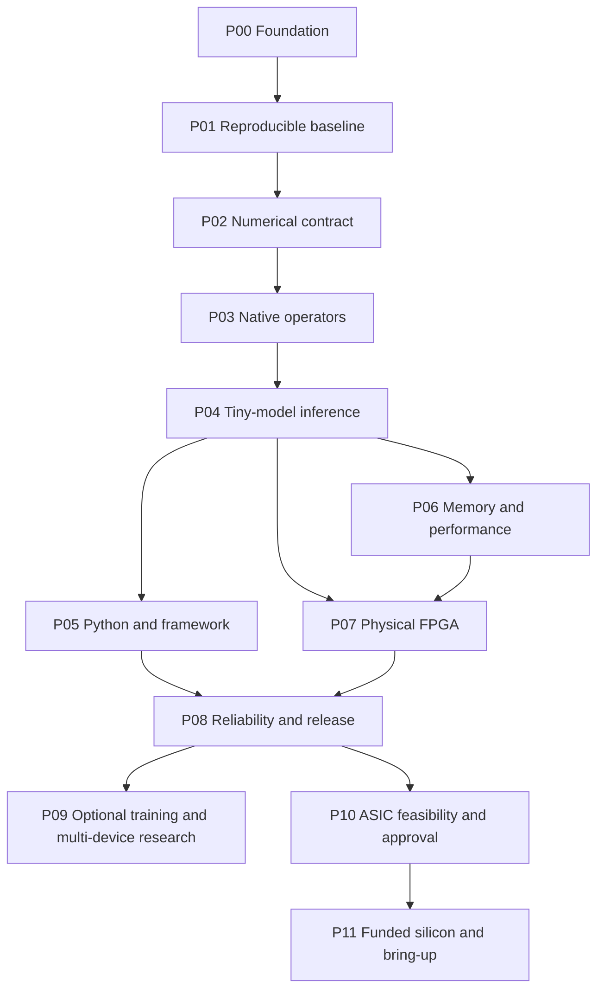

# AI-GPU development roadmap

**The goal is a programmable AI accelerator, built on Vortex, with a path from
correct calculations to a useful model, a real FPGA prototype and potentially
custom silicon.** “NVIDIA-style” describes that architectural ambition; it does
not promise NVIDIA performance, CUDA compatibility or a finished commercial GPU.

This page explains the route. [Current status](docs/project/status.md) says where
work actually stands. [roadmap.json](docs/project/roadmap.json) is authoritative
for dependencies, owners' roles, the **36 acceptance criteria across 12 phases**,
completion state and evidence references. A plan is not a test result.

## The route in plain language

1. **Prove the existing building blocks.** Reproduce the inherited GPU and tensor
   calculations on one small, pinned configuration before changing their behavior.
2. **Give AI programs usable building blocks.** Turn native matrix multiplication
   and related kernels into a tested operator library, then run one complete tiny
   model. Inference means using a model to produce an answer; training is separate.
3. **Make that model accessible and efficient.** Add a thin Python/framework
   bridge and improve measured memory or execution bottlenecks. These two branches
   can proceed independently after native model execution is accepted.
4. **Prove it on a physical board.** An FPGA is reconfigurable hardware on which
   the GPU design can be tested with real external memory and host transfers.
   Qualify that prototype before calling it a reliable experimental release.
5. **Decide whether to manufacture a chip.** An ASIC is a custom manufactured
   chip. It requires qualified physical design, memory/interface IP, packaging,
   specialist ownership, funding and explicit human approval—not just more code.

The first product-shaped milestone is **one fixed tiny model executed through
the native Vortex runtime, with correct outputs and traces proving where its work
ran**. A replacement HIP compiler is not required for this first milestone.
See the [charter](docs/project/charter.md), [inherited baseline](docs/project/baseline.md)
and [architecture](docs/project/architecture.md) for scope and existing foundations.

## Dependencies, not a calendar promise

Arrows mean prerequisite acceptance. Preparatory investigation may inform later
decisions, but it does not bypass a phase's exit gates.

**P09 is not a prerequisite for P10/P11.** A bounded inference chip need not wait
for training or multiple-device research. Python is also not required for P07's
native FPGA demonstration, but P08 combines the Python and physical-board paths.
No tapeout date, board purchase, memory capacity, clock or performance target is
approved by this roadmap; those decisions need evidence and accountable owners.

## Phases and observable exits

Each linked phase guide contains entry conditions, ordered work packages,
deliverables, acceptance IDs `Pxx-A01`–`Pxx-A03`, stop conditions and handoff.
The summaries below do not replace the exact criteria in the canonical manifest.

| Phase | What we build or establish | Requires | What closes the phase |
|---|---|---|---|
| [P00 — Project foundation](docs/project/phases/p00-foundation.md) | A clear, resumable development contract | None | Complete navigation and preserved image; passing offline validation/tests; resolved independent review and verified publication |
| [P01 — Reproducible baseline](docs/project/phases/p01-baseline.md) | Proof that the chosen inherited configuration builds and runs | P00 | Pinned clean build; native FP16/BF16 GEMM and supported attention reference checks; full XRT hardware-emulation integration evidence |
| [P02 — Tensor numerical contract](docs/project/phases/p02-tensor.md) | Defined arithmetic and supported formats | P01 | Reviewed numerical rules; native edge/layout tests; WGMMA synchronization/backpressure and applicable parity evidence |
| [P03 — AI operator library](docs/project/phases/p03-operators.md) | Reusable native AI operations and safe runtime wrappers | P02 | Versioned operator/support manifest; independent reference checks with dispatch traces; buffer/lifetime/error tests |
| [P04 — Tiny-model inference](docs/project/phases/p04-inference.md) | One complete fixed model on the native path | P03 | Reproducible licensed fixture; matching intermediate/final outputs; traced device work and separately reported host work/transfers |
| [P05 — Python and framework integration](docs/project/phases/p05-framework.md) | A thin Python binding and scoped PyTorch custom operators | P04 | Binding/lifetime/install tests; model agreement and device dispatch; tested-version/operator compatibility matrix |
| [P06 — Memory and performance scaling](docs/project/phases/p06-performance.md) | Evidence-led optimization of useful work and data movement | P04 | Frozen benchmark records; correctness-preserving before/after results and applicable gates; explicit resource/timing budgets |
| [P07 — Physical FPGA prototype](docs/project/phases/p07-fpga.md) | One real board running the native model with real DRAM and host transfers | P04, P06 | Recorded target/bitstream/achieved clock; physical DMA/memory/compute/model tests; one-hour initial soak without unexplained errors |
| [P08 — Reliability and release hardening](docs/project/phases/p08-reliability.md) | A reproducible, bounded experimental release | P05, P07 | Physical fault/recovery/isolation tests; 24-hour physical soak; reviewed reproducible artifacts, licenses and compatibility evidence |
| [P09 — Training and multi-device research](docs/project/phases/p09-research.md) | Separately qualified training and two-device operation | P08; explicitly activated research scope | Physical gradient/convergence proof; collective ordering/failure/recovery tests; measured communication and scaling costs |
| [P10 — ASIC feasibility and sign-off planning](docs/project/phases/p10-asic.md) | An evidence-backed decision on a bounded inference chip | P08 | Qualified PDK/macros/interface IP/package/tool availability; complete sign-off plans; human-approved scope, budget, ownership and partners |
| [P11 — Funded silicon realization and bring-up](docs/project/phases/p11-silicon.md) | Authorized fabrication and measured packaged silicon | P10 | Qualified manufacturing sign-off; actual board/silicon bring-up; frozen-model execution and honest measured operating limits |

## What counts as progress

Use the [acceptance policy](docs/project/acceptance.md) and
[evidence format](docs/project/evidence/README.md). Source inspection,
simulation, native RTL verification, physical FPGA measurements and silicon
measurements are different kinds of proof. Report the exact revision,
configuration, backend, commands, results, artifact hashes and limitations.

- A DPI arithmetic simulation cannot prove the native tensor datapath.
- Processor-only `rtlsim` cannot replace full AFU integration; `hw_emu` cannot
  replace a physical FPGA run. Missing required integration remains blocked.
- A custom-op bridge does not establish a complete PyTorch device backend,
  autograd, arbitrary model support or CUDA binary compatibility.
- More cores, a named commercial-GPU simulation profile or theoretical peak
  arithmetic do not establish faster real applications or market equivalence.
- Real memory requires a supported physical controller/PHY, wiring and package
  integration. Changing a simulated memory-size setting does not supply DRAM/HBM.
- Synthesis estimates and a generated layout are not manufacturing sign-off or
  measured silicon. Hardware purchases and fabrication need separate authority.

Complete a phase only when its dependencies and every gate have compatible
passing evidence and required review. Freeze thresholds before evaluation;
preserve failed results, inherited tests and golden data. A completed agent task,
document or governance check cannot stand in for unexecuted GPU tests.

## Where to start, and how to continue

Read [status](docs/project/status.md), then the
[ordered backlog](docs/project/backlog.md). After P00 acceptance, the first bounded
tasks are **P01-T01: environment/provenance manifest** and **P01-T02: a reviewed,
small native test matrix**. Resolve tools, platform access and a disk/RAM/job/time
budget before any substantial download or build.

Use the [developer guide](docs/project/developer-guide.md) for safe setup,
[requirements](docs/project/requirements.md) for traceability,
[verification](docs/project/verification.md) and [benchmarks](docs/project/benchmarks.md)
for proof, and [decisions](docs/project/decisions.md) / [risks](docs/project/risks.md)
for unresolved choices. Follow [AGENTS.md](AGENTS.md) and
[contribution guidance](CONTRIBUTING.md) when implementing work.

Every continuation leaves an [explicit handoff](docs/project/handoff.example.md):
what changed, exact tests and not-runs, remaining blockers, publication state and
one next bounded action. Update phase evidence and current status together.
