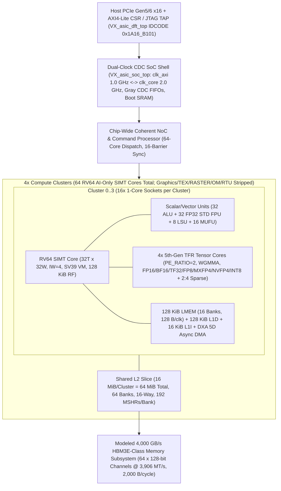

# AI-GPU B1 Architecture & Engineering Datasheet (`aigpu-b1` & `aigpu-b1-tile`)

**Document Class:** Investor & Engineering Technical Dataroom Datasheet  
**Target Silicon Profiles:** [`aigpu-b1`](file:///home/antigravity/baabi-boo/AI-GPU/profiles/aigpu-b1.json) (64-Core Datacenter AI-Only SoC) & [`aigpu-b1-tile`](file:///home/antigravity/baabi-boo/AI-GPU/profiles/aigpu-b1-tile.json) (4-Core MPW Compute Tile)  
**Baseline Architecture:** RV64IMAFD + AI Tensor Extensions (Derived from Vortex, Graphics/RTU Stripped)  
**Authoritative Evidence Flags:** `foundry_signoff: false` | `silicon_measured: false` | `fpga_measured: false` | `clean_ip_verified: true`

> [!IMPORTANT]
> **Strict Evidence Discipline (ADR-002 & ADR-006):**
> Every figure in this datasheet is tagged with its exact repository evidence level (`source_present`, `simulated` / `modeled_analytical` / `parametric_presilicon_estimate`, `rtl_verified`, or `open_source_synth_pnr_gds`). **Zero** physical FPGA (`fpga_measured`) or manufactured silicon (`silicon_measured`) measurements exist today. Vendor XRT `hw_emu` (`P01-A03`) remains `blocked`, and phases `P07`–`P11` remain `not_started` and unwaived pending physical Alveo FPGA hardware and commercial foundry sign-off (`ODR-007`/`ODR-008`, `go_approved = false`).

---

## 1. Executive Overview & Strict Evidence Discipline (ADR-006)

**AI-GPU B1 (`aigpu-b1`)** is an open-source, Apache-2.0-clean, 64-bit RISC-V (`RV64IMAFD`) SIMT + Tensor Core AI accelerator architecture designed for datacenter LLM prefill, autoregressive decode, and multi-precision matrix inference. Derived from the Vortex GPGPU microarchitecture, `aigpu-b1` explicitly strips all graphics, texture, rasterization, output-merger, and ray-tracing hardware (`VX_CFG_EXT_{TEX,RASTER,OM,RTU}_ENABLE = false`) to dedicate silicon area and memory bandwidth exclusively to 5th-generation Tensor Core Units (`TFR` + `WGMMA`), `DXA` asynchronous 5D tensor DMA, `MUFU` special-function transcendentals, and on-die SRAM.

To enable rigorous RTL verification and a risk-reduced Multi-Project Wafer (MPW) bring-up path without overclaiming full-chip closure, the program pairs two profile-pinned targets under [ADR-006](file:///home/antigravity/baabi-boo/AI-GPU/docs/project/decisions.md#L186-L254) and [`presilicon_readiness.json`](file:///home/antigravity/baabi-boo/AI-GPU/docs/project/presilicon_readiness.json):

- **`aigpu-b1` (Datacenter AI-Only SoC Target):** 64 RV64 cores (`4 clusters × 16 cores`), `32T × 32W`, `IW=4`, `8,192` FP32 lanes, `256` TFR tensor blocks (`PE_RATIO=2`), `100.34 MiB` total on-die SRAM (`64 MiB` L2 + `16 MiB` physical mirrored LMEM), and a modeled `4.0 TB/s` HBM3E-class memory subsystem at `2.0 GHz`.
- **`aigpu-b1-tile` (MPW / RTL-Verifiable Compute Tile Slice):** 4 RV64 cores (`1 cluster × 1 4-core socket`), `8T × 8W`, `IW=2`, `64` FP32 lanes, `8` TFR tensor blocks (`PE_RATIO=1`), full Blackwell-class AI ISA (`FP16/BF16`, `FP8`, `MXFP4`, `NVFP4`, `INT8`, `2:4` sparsity, `WGMMA`, `DXA`, `MUFU`), `256 KiB` write-back L2, and `0.516 MiB` total on-die SRAM.

### Evidence Classification Matrix (Zero Conflation Policy)

| Domain / Artifact | Evidence Label | Physical / Sign-Off Status | What Is Established | Authoritative Source |
|---|---|---|---|---|
| Native AI Operators, Tiny-MLP, Transformer v2, LLM Ops v3, 2-Layer Llama `.safetensors` | **`rtl_verified`** *(1-core `p02-tfr`)* | `fpga_measured: false`, `silicon_measured: false` | Bit-exact / tolerance-checked execution on SimX **and** native Verilator processor RTL (`rtlsim`) on `p02-tfr` RV64 STD/TFR hardware (zero DPI arithmetic substitution) | [`rtl_ai_and_xrtsim_evidence.json`](file:///home/antigravity/baabi-boo/AI-GPU/docs/project/evidence/presilicon-b1-tile/rtl_ai_and_xrtsim_evidence.json), commits `786f0ee`, `cc459f8`, `3f12943`, `296feeb`, `a041e71` |
| Full-AFU `xrtsim` `demo` & P01 Local AFU Matrix | **`rtl_verified`** *(local shim)* | `P01-A03` (`hw_emu`) **`blocked`** | `build64` RV64 local XRT shim + AFU RTL (`demo`: `2,460` instrs, `6,386` cycles) and committed `p01` local matrix (`192` instrs, `608` cycles); does **not** certify vendor `hw_emu` | [`rtl_ai_and_xrtsim_evidence.json`](file:///home/antigravity/baabi-boo/AI-GPU/docs/project/evidence/presilicon-b1-tile/rtl_ai_and_xrtsim_evidence.json), [`p01-local-qualification/index.json`](file:///home/antigravity/baabi-boo/AI-GPU/docs/project/evidence/p01-local-qualification/index.json) |
| Formal Proofs (JTAG TAP, Gray CDC FIFO) & 70-SVA Dual-Clock Stress Bench | **`rtl_verified`** | `foundry_signoff: false` | 4/4 Yosys 0.69 + Z3 4.8.12 `k`-induction/BMC proofs (`dft_tap_k_induction` bound directly to `dut.tap_state_q` via `read_slang` with 4/4 DUT mutation negative controls) + Verilator `--assert --coverage` (`96.9%` DUT line coverage, 0 SVA failures) | [`hw/dv/dv_results.json`](file:///home/antigravity/baabi-boo/AI-GPU/hw/dv/dv_results.json) |
| OpenROAD ORFS RTL→GDSII, Yosys 0.69, OpenSTA 3.1.0, OpenRCX, KLayout | **`open_source_synth_pnr_gds`** | `foundry_signoff: false` | 4 PDN-routed `0`-DRC GDSII macros on academic ASAP7 7nm / Nangate45 + `fakeram7_256x32`; establishes physical routing/timing trends, **not** foundry sign-off | [`hw/asic/phys/phys_results.json`](file:///home/antigravity/baabi-boo/AI-GPU/hw/asic/phys/phys_results.json) |
| `aigpu-b1-tile` 8-Workload Blackwell Tensor/DXA/AMO Suite | **`simulated`** | `silicon_measured: false` | All 8 workloads (`FP8`, `MXFP4`, `NVFP4`, `WGMMA`, `2:4` Sparse, `DXA`, `WGMMA+DXA`, `AMO`) verified on 4-core + 256 KiB L2 `aigpu-b1-tile` SimX | [`b1_tile_simx_suite.json`](file:///home/antigravity/baabi-boo/AI-GPU/docs/project/evidence/presilicon-b1-tile/b1_tile_simx_suite.json) |
| Analytical Roofline (`b1_roofline_compare.py`) & Parametric PPA (`aigpu_ppa_model.py`) | **`simulated`** / **`modeled_analytical`** | `silicon_measured: false`, `foundry_signoff: false` | Parameterized TFLOPS/TOPS, HBM3E ridge points, Llama prefill/decode ceilings, and N4P/N3E/ASAP7 area/power projections anchored to ASAP7 EDA & SRAM manifest | [`b1_roofline_compare.py`](file:///home/antigravity/baabi-boo/AI-GPU/ci/project/b1_roofline_compare.py), [`aigpu_ppa_model.py`](file:///home/antigravity/baabi-boo/AI-GPU/ci/project/aigpu_ppa_model.py) |
| Clean RTL Handoff, SRAM Manifest, Multi-Clock SDC, UPF 2.1, Foundry RFQ | **`source_present`** | `clean_ip_verified: true`, `go_approved: false` | 443 clean Apache-2.0/BSD-permissive files (`424` RTL files, `101,282` RTL lines), 22/22 CDC SDC pairs matched in OpenSTA, 0 forbidden IP markers | [`foundry-rfq-package.md`](file:///home/antigravity/baabi-boo/AI-GPU/docs/dataroom/foundry-rfq-package.md) |

---

## 2. Chip Microarchitecture & Block Architecture

### 2.1 Side-by-Side Profile Comparison (`aigpu-b1` vs. `aigpu-b1-tile`)

| Architectural Parameter | `aigpu-b1` (Datacenter AI-Only SoC) | `aigpu-b1-tile` (MPW Compute Tile) | Notes / Source |
|---|---|---|---|
| **ISA & Address Space** | `RV64IMAFD` + `A` + `Zacas` + `Zicond` + `Zfhmin` + `SV39` VM (48-bit mem addr) | `RV64IMAFD` + `A` + `Zicond` + `Zfhmin` (48-bit mem addr) | Graphics (`TEX`/`RASTER`/`OM`/`RTU`) disabled |
| **Cluster × Socket × Core** | **4 clusters × 16 (1-core) sockets = 64 cores** | **1 cluster × 1 (4-core) socket = 4 cores** | `SOCKET_SIZE`: `1` (B1) vs `4` (Tile) |
| **SIMT Geometry** | **32 warps × 32 threads/core** (`IW=4`, `FW=4`, `2` OPCs) | **8 warps × 8 threads/core** (`IW=2`, `FW=2`, `1` OPC) | `1,024` threads/core (B1) vs `64` (Tile) |
| **Scalar Vector Lanes** | 32 ALU + 32 FP32 FPU + 8 LSU lanes/block (`8,192` FP32 lanes chip-wide) | 8 ALU + 8 FP32 FPU + 8 LSU lanes/block (`64` FP32 lanes chip-wide) | `VX_CFG_FPU_TYPE = "STD"` (no DPI) |
| **Transcendentals & Sync** | 16-lane `MUFU` (`32` SFU lanes), `16` hardware barriers/core | `MUFU` enabled, `8` hardware barriers/core | Native `fsqrt`, `exp`/`tanh`/`sin`/`cos` |
| **Tensor Core (`TFR` + `WGMMA`)** | **4 TCU blocks/core (256 total)**, `PE_RATIO=2` (`16` PEs × `4`-word FEDP = `64` FMA32/clk/blk) | **2 TCU blocks/core (8 total)**, `PE_RATIO=1` (`8` PEs × `2`-word FEDP = `16` FMA32/clk/blk) | `8×4×4` tile (B1) vs `4×2×2` / `8×8×8` WMMA (Tile) |
| **Tensor Precisions & Sparsity** | `FP16`/`BF16`, `TF32`, `FP8`/`MXFP8`, `MXFP4`, `NVFP4`, `INT8`, `WGMMA`, **`2:4` Sparse** | `FP16`/`BF16`, `FP8`/`MXFP8`, `MXFP4`, `NVFP4`, `INT8`, `WGMMA`, **`2:4` Sparse** (`TF32` off) | Native STD/TFR RTL datapaths |
| **Async Tensor DMA (`DXA`)** | 1 `DXA` engine/socket (`64` engines), 16-slot 5D descriptor table + 16-entry FIFO | 1 `DXA` engine/socket (`1` engine), 16-slot 5D descriptor table + 16-entry FIFO | TMA-class async global↔LMEM copy & multicast |
| **L1 Caches & Local Mem** | `16 KiB` I$ (4B), `128 KiB` D$ (4-way, 4B, 24 MSHRs), `128 KiB` LMEM (16B = 128 B/clk) | `16 KiB` socket I$ (2B), `16 KiB` socket D$ (1B), `16 KiB` LMEM/core (8B) | LMEM write-mirrored `VX_1rw1r_ram` under ASIC |
| **Shared L2 Cache** | **64 MiB** (`16`-way, `64` banks = `16`/cluster, `128 B` lines, `192` MSHRs/bank) | **256 KiB** write-back (`8`-way, `1` bank, `128 B` lines) | L2 write-through in multi-cluster B1 |
| **Total On-Die SRAM (Manifest)** | **100.335327 MiB** (`841,673,728` bits across **8,256** logical arrays / `22,784` cuts) | **0.516045 MiB** (`4,328,896` bits across **131** logical arrays / `218` cuts) | [`sram_macro_manifest.json`](file:///home/antigravity/baabi-boo/AI-GPU/hw/asic/sram/sram_macro_manifest.json) |
| **Target Clock & Memory BW** | **2,000 MHz** (`clk_core`), **4,000 GB/s** HBM3E-class (`64 × 128b @ 3906 MT/s`) | **400 MHz** modeled baseline, **460 GB/s** (`VX_config.toml` sim baseline) | Pre-silicon target envelopes |

### 2.2 `aigpu-b1` SoC Architecture Block Diagram



```text
+---------------------------------------------------------------------------------------------------+
|  aigpu-b1 SoC Shell (VX_asic_soc_top + VX_asic_dft_top): AXI4-Lite CSR | Boot SRAM | JTAG/MBIST  |
+---------------------------------------------------------------------------------------------------+
                                                 |  (clk_axi 1.0 GHz <-> clk_core 2.0 GHz Gray CDC)
+---------------------------------------------------------------------------------------------------+
|  Cluster 0 (16 Cores, 16 MiB L2)  |  Cluster 1 (16 Cores, 16 MiB L2)  |  Cluster 2  |  Cluster 3  |
|  +-----------------------------+  +-----------------------------+     |  (16 Cores) |  (16 Cores) |
|  | Core x16 (32W x 32T, IW=4)  |  | Core x16 (32W x 32T, IW=4)  |     |  16 MiB L2  |  16 MiB L2  |
|  | 4x TFR TCU (PE_RATIO=2)     |  | 4x TFR TCU (PE_RATIO=2)     |     +-------------+-------------+
|  | 16x MUFU | DXA | 128K LMEM  |  | 16x MUFU | DXA | 128K LMEM  |                                 |
|  +-----------------------------+  +-----------------------------+                                 |
+---------------------------------------------------------------------------------------------------+
         |                               |                                  |                 |
         +-------------------------------+----------------------------------+-----------------+
                                         v
             Modeled 4,000 GB/s HBM3E-Class Fabric (64 Channels x 128-bit @ 3,906 MT/s)
```

---

## 3. 5th-Gen Tensor Core (`TFR`/`WGMMA`) & Memory Hierarchy Specification

### 3.1 Modeled Analytical Peak Compute & Ridge Points (`b1_roofline_compare.py`)

All values below are exact outputs of [`ci/project/b1_roofline_compare.py`](file:///home/antigravity/baabi-boo/AI-GPU/ci/project/b1_roofline_compare.py) (`evidence_level: "modeled_analytical"`, `silicon_measured: false`). In Vortex's `TFR` TCU microarchitecture (`VX_tcu_core.sv`), each TCU block instantiates `(TC_M × TC_N) / PE_RATIO` FEDP processing elements computing `FEDP_K = TC_K` 32-bit FMA word-dot terms per cycle (`8×4/2 × 4 = 64` word-FMAs/cycle/block on `aigpu-b1`; `256` blocks × `64` = `16,384` word-FMAs/cycle chip-wide).

| Precision / Datapath | `aigpu-b1` Dense Peak | `aigpu-b1` 2:4 Sparse Peak | `aigpu-b1` Ridge (D / S, Op/B) | `aigpu-b1-tile` Dense / 2:4 Sparse | `aigpu-b1-tile` Ridge (D / S, Op/B) |
|---|---:|---:|---:|---:|---:|
| **Scalar FP32 (`STD` FPU)** | `32.768 TFLOPS` | N/A | `8.192` / — | `0.0512 TFLOPS` / N/A | `0.111` / — |
| **TF32 (`TFR` TCU)** | `65.536 TFLOPS` | `131.072 TFLOPS` | `16.384` / `32.768` | Unsupported (`false`) | — |
| **FP16 / BF16 → FP32 (`TFR` TCU)** | **`131.072 TFLOPS`** | **`262.144 TFLOPS`** | `32.768` / `65.536` | `0.2048` / `0.4096 TFLOPS` | `0.445` / `0.890` |
| **FP8 (E4M3/E5M2) / MXFP8** | **`262.144 TFLOPS`** | **`524.288 TFLOPS`** | `65.536` / `131.072` | `0.4096` / `0.8192 TFLOPS` | `0.890` / `1.781` |
| **INT8 (`TFR` TCU)** | **`262.144 TOPS`** | **`524.288 TOPS`** | `65.536` / `131.072` | `0.4096` / `0.8192 TOPS` | `0.890` / `1.781` |
| **MXFP4 (OCP 4-bit + MX Scale)** | **`524.288 TOPS`** | **`1,048.576 TOPS`** | `131.072` / `262.144` | `0.8192` / `1.6384 TOPS` | `1.781` / `3.562` |
| **NVFP4 (4-bit + Block Scale)** | **`524.288 TOPS`** | **`1,048.576 TOPS`** | `131.072` / `262.144` | `0.8192` / `1.6384 TOPS` | `1.781` / `3.562` |

*Scaling Note:* `aigpu-b1` scales over `aigpu-b1-tile` by `16.0×` cores (`64` vs `4`), `5.0×` clock (`2,000` vs `400 MHz`), `8.70×` modeled bandwidth (`4,000` vs `460 GB/s`), and **`640.0×` peak FP16 dense TFLOPS** (`131.072` vs `0.2048 TFLOPS` due to `16×` cores × `2×` TCU blocks/core × `4×` word-FMAs/block × `5×` clock).

### 3.2 Llama Prefill vs. Decode Roofline Workpoint Analysis (`K=4096, N=14336`)

Using idealized GEMM arithmetic intensity `2·M·N·K / ((M·K + K·N + M·N) · bytes_per_elem)` (including `1 B / 16` elements scale overhead for `NVFP4`):

| Llama-3-8B Projection Workpoint | Arith. Intensity (Op/B) | `aigpu-b1` BW Ceiling | `aigpu-b1` Attained (Dense / 2:4 Sparse) | `aigpu-b1` Regime | Ref `H100` / `RTX 5080` Attained (Dense) |
|---|---:|---:|---:|---|---|
| **Prefill FP16/BF16** (`M=4096`) | `1,792.00` | `7,168.00 TFLOPS` | **`131.072 / 262.144 TFLOPS`** | `compute-bound` | `535.27` (H100 Vortex) / `197.41` (5080 Vortex) |
| **Prefill FP8** (`M=4096`) | `2,493.22` | `9,972.87 TFLOPS` | **`262.144 / 524.288 TFLOPS`** | `compute-bound` | `1,070.53` (H100 Vortex) / `394.81` (5080 Vortex) |
| **Prefill NVFP4** (`M=4096`) | `3,008.21` | `12,032.84 TOPS` | **`524.288 / 1,048.576 TOPS`** | `compute-bound` | H100 `unsupported` / `789.63` (5080 Vortex) |
| **Decode FP16/BF16** (`M=1`) | `1.00` (`0.9997`) | `3.999 TFLOPS` | **`3.999 TFLOPS`** (D & S) | `memory-bound` | `3.349` (H100) / `0.960` (5080) |
| **Decode FP8** (`M=1`) | `2.00` (`1.9989`) | `7.996 TFLOPS` | **`7.996 TFLOPS`** (D & S) | `memory-bound` | `6.696` (H100) / `1.919` (5080) |
| **Decode NVFP4** (`M=1`) | `3.55` (`3.5522`) | `14.209 TOPS` | **`14.209 TOPS`** (D & S) | `memory-bound` | H100 `unsupported` / `3.410` (5080) |

**Key Architectural Insight:** Single-token autoregressive decode (`M=1`) is strictly HBM3E memory-bandwidth bound (`AI = 1.0–3.55 Op/B`). On `aigpu-b1`, native hardware `NVFP4` / `MXFP4` 4-bit weight compression increases effective decode throughput by **`3.55×`** over FP16/BF16 (`14.209 TOPS` vs `3.999 TFLOPS`) and outperforms H100 SXM5's `3.35 TB/s` HBM3 ceiling (`6.70 TFLOPS` FP8) by `19.4%` in FP8 decode and `2.12×` via native 4-bit decode.

### 3.3 Exact On-Die SRAM Subsystem Specification (`sram_macro_manifest.json`)

| SRAM Subsystem | RTL Module / Wrapper | `aigpu-b1` Arrays | `aigpu-b1` Bits / MiB | `aigpu-b1-tile` Arrays | `aigpu-b1-tile` Bits / MiB |
|---|---|---:|---:|---:|---:|
| **Register File (`rf_gpr_bank`)** | `VX_opc_unit` / `VX_sram_1r1w` | `512` | `67,108,864` (**8.000 MiB**) | `16` | `524,288` (`0.0625 MiB`) |
| **I-Cache (`icache_tag`, `icache_data`)** | `VX_cache_*` / `1r1w` + `1rw` | `4,352` | `8,978,432` (**1.070 MiB**) | `34` | `140,288` (`0.0167 MiB`) |
| **D-Cache (`dcache_tag`, `dcache_data`)** | `VX_cache_*` / `1r1w` + `1rw` | `768` | `71,434,240` (**8.516 MiB**) | `3` | `140,288` (`0.0167 MiB`) |
| **Local Shared Memory (`lmem_bank`)** | `VX_lmem_unit` (`2× 1r1w` mirrored) | `2,048` | `134,217,728` (**16.000 MiB**) | `64` | `1,048,576` (`0.1250 MiB`) |
| **Shared L2 Cache (`l2_tag`, `l2_data`, `dirty`)** | `VX_cache_*` / `1r1w` + `1rw` | `192` | `550,502,400` (**65.625 MiB**) | `4` | `2,426,880` (`0.2893 MiB`) |
| **TCU Metadata Store (`tcu_meta`)** | `VX_tcu_meta` / `VX_sram_1r1w` | `256` | `8,388,608` (**1.000 MiB**) | `8` | `32,768` (`0.0039 MiB`) |
| **DXA Descriptor & Command FIFO** | `VX_dxa_*` / `VX_sram_1r1w` | `128` | `1,043,456` (**0.124 MiB**) | `2` | `15,808` (`0.0019 MiB`) |
| **Total On-Die SRAM** | **7 Subsystems (`22,784` / `218` physical cuts)** | **8,256** | **841,673,728 (`100.335327 MiB`)** | **131** | **4,328,896 (`0.516045 MiB`)** |

---

## 4. RTL-Verified AI Workload & End-to-End LLM Benchmark Results

Every native RV64 kernel below executes with **zero external `libm` dependencies** and **zero DPI floating-point/tensor substitution**, verified against IEEE-754 `fp64` CPU references on both SimX and native processor RTL (`rtlsim`).

| Workload / Suite | Commit | Scope & Operator Coverage | Retired Instrs (SimX / `rtlsim`) | Cycles (SimX / `rtlsim`) & Parity | Numerical Accuracy & Mismatches | Evidence Level |
|---|---|---|---|---|---|---|
| **Fused Native Tiny-MLP (`ai_mlp_fused`, `P06-A02`)** | `786f0ee` | Single-launch 4-warp `16→8→4` MLP w/ LMEM bridge, on-device ReLU + IEEE-754 RNE casts (`0` host round-trip vs `3` launches / `18,189` cycles / `2,688 B` baseline) | BF16: `3,256` (`rtlsim`); FP16: `3,946` / `3,946` (`0` delta) | **BF16:** `10,130` (`-n1`) / `9,913` (`-n2`) / `10,078` `rtlsim` (`1.80x` speedup, `0.51%` parity); **FP16:** `12,628` / `12,573` (`1.44x` speedup, `0.44%` parity) | `0` mismatches (`320/320` logits, `640/640` hidden, `320/320` bridge; 5-case BF16 `rtlsim` `16,040` instrs / `49,278` cycles) | **`rtl_verified`** |
| **Native AI Operators v2 (`ai_ops_v2`)** | `cc459f8` | 10/10 opcodes: `relu_fp32`, `gelu_fp32`, `cast_fp32_to_fp16`, `cast_fp16_to_fp32`, `cast_fp32_to_bf16`, `cast_bf16_to_fp32`, `softmax_fp32`, `rmsnorm_fp32`, `layernorm_fp32`, `attention_fp32` | `40,030` / `40,030` (**exact**) | `159,046` / `158,597` (**`0.28%`** parity) | `0/368` mismatches (bit-exact `0.0` for ReLU & 4 casts; `<=2.5e-7` `max_abs_err` for GELU/norm/attn) | **`rtl_verified`** |
| **1-Layer Device-Resident Transformer (`ai_transformer_v2`)** | `3f12943` | `seq=8, d=16, H=2, d_ff=16`: Pre-RMSNorm, Q/K/V TCU matmuls, 2-head attention, Wo+Res, FFN (`W1`+GELU+`W2`+Res); `45` launches + `48` D2D (`0` host bytes) | `83,263` / `83,263` (**exact**) | `436,010` / `434,234` (**`0.41%`** parity) | **`max_abs_err = 1.352902e-4`** (tol `5e-4`), **`0/128` mismatches** | **`rtl_verified`** |
| **Blackwell LLM Operators v3 (`ai_llm_ops_v3`)** | `296feeb` | 11/11 cases across 8 opcodes: `RoPE` (prefill/decode), `SwiGLU`, bit-exact `KV-cache`, `4:2 GQA` decode, causal & non-causal LMEM-tiled `FlashAttention` (`Br=4, Bc=4, 1,088 B LMEM`), `RMSNorm`, `Add`, `GEMV/GEMM` | `409,824` / `409,824` (**exact**) | `1,854,142` / `1,853,620` (**`0.028%`** parity) | **`0/3,312` mismatches**, `max_abs_err <= 2.78e-7` | **`rtl_verified`** |
| **End-to-End 2-Layer Llama `.safetensors` LLM (`aigpu_llm`)** | `a041e71` | 21 binary `.safetensors` tensors (`vocab=32, 2L, d=16, 2:1 GQA, d_ff=16`), `170` native GPU launches (prefill `P=4` + `4`-step KV-cache decode, `0` intermediate host bytes) | `820,178` / `820,178` (**exact**) | `2,772,330` / `2,763,450` (**`0.32%`** parity) | **Exact token-for-token match** (`prefill=25`, `decode=[3,12,8,31]`), **`max_abs_err = 4.66e-7`** (tol `5e-4`) | **`rtl_verified`** |
| **`aigpu-b1-tile` Blackwell Tensor/DXA/AMO & Full-AFU `xrtsim`** | `b1_tile_simx_suite.json` / `rtl_ai_and_xrtsim_evidence.json` | 8/8 `aigpu-b1-tile` 4-core+L2 SimX suites (`FP8`, `MXFP4`, `NVFP4`, `WGMMA FP16`, `WGMMA 2:4 Sparse`, `DXA`, `WGMMA+DXA`, `AMO`) + `build64` full-AFU `xrtsim` `demo` | `demo`: `2,460` (`xrtsim` & `SIMX_MT=2` vs `rtlsim`) | `xrtsim` `demo`: `6,386` cycles (`IPC=0.385`); `SIMX_MT=2`: `6,448` SimX vs `6,404` `rtlsim` | `8/8` SimX suites PASS; `demo` 16/16 exact (`xrtsim` local shim, not vendor `hw_emu`) | **`simulated`** (8-suite) / **`rtl_verified`** (`xrtsim` `demo`) |
| **Python AI SDK & ONNX/PyTorch FX Compiler** | `304945f` | `python/aigpu_sdk/`: `.safetensors` mmap I/O, typed SSA IR, ONNX & PyTorch FX frontends, fusion (`SiLU*mul→SwiGLU`, `MatMul+Add`, `RMSNorm+Cast`), interval-coloring pool planner | Host Python unit tests (preserving frozen 23-file P05 `vortex_ai`) | `test_p05_packaging.py` `29/29`, `test_resident_v2.py` `6/6`, `test_aigpu_compiler.py` `12/12` (`0` skips) | Zero intermediate host copies planned; `check_project.py` PASS | **`source_present`** / **`simulated`** |

---

## 5. Physical Design Proof (OpenROAD RTL→GDSII, Yosys, OpenSTA) & Parametric PPA Scaling

### 5.1 OpenROAD ORFS Place-and-Route → PDN → OpenRCX → KLayout 0-DRC GDSII Proof

All four physical layouts below completed full Yosys 0.69 elaboration/synthesis (`read_slang`), OpenROAD placement, `pdngen` power-grid generation (routed `VDD`/`VSS` `SPECIALNETS` verified in every `.def`), clock-tree synthesis (CTS), setup/hold timing repair, global routing, TritonRoute detailed routing (**`0` DRC violations**), filler/decap insertion, OpenRCX 3D parasitic `.spef` extraction, post-route OpenSTA 3.1.0 timing/power, and KLayout `.gds` streamout (`source_revision: 0775c9a`, `foundry_signoff: false`).

| Macro / Top | PDK | Die Size & Area (µm²) | Design Area (µm²) | Util (%) | PDN Segs | Wirelength (µm) / Vias | DRT DRC | Post-Route Setup WNS / TNS (ns) | Min Hold Slack (ns) | Post-Route Fmax (MHz) | Power (mW) | GDSII Size & KLayout Check |
|---|---|---:|---:|---:|---:|---:|---:|---:|---:|---:|---:|---|
| **`VX_asic_dft_top`** | ASAP7 7nm | `15.526 × 15.526` (`241.06`) | `110.0` | `62.0%` | `780` | `2,186` / `7,279` | **0** | `0.0000` / `0.0000` | `+0.0264` | `173.94` (`tck`) | `0.019938` | `1,046,438 B` (`70` cells, `32` layers) |
| **`VX_asic_dft_top`** | Nangate45 | `58.215 × 58.215` (`3,388.99`) | `1,122.0` | `46.0%` | `162` | `6,691` / `4,156` | **0** | `0.0000` / `0.0000` | `+0.0259` | `173.35` (`tck`) | `0.14853` | `598,488 B` (`57` cells, `22` layers) |
| **`VX_tcu_tfr_mul_f16`** (`PROD_REG=1`) | ASAP7 7nm | `30.636 × 30.636` (`938.56`) | `348.0` | `43.0%` | `2,958` | `12,932` / `30,684` | **0** | `0.0000` / `0.0000` | `+0.0294` | **`1,079.53`** (`clk`) | `0.25077` | `3,137,082 B` (`90` cells, `34` layers) |
| **`VX_asic_soc_top`** (`fakeram7_256x32`) | ASAP7 7nm | `80.000 × 80.000` (`6,400.00`) | `2,131.0` | `37.0%` | `16,866` | `64,317` / `129,741` | **0** | `-0.0085` / `-0.0288` *(at 2.0 GHz)* | `+0.0242` | **`1,966.66`** (`clk_core`) / **`1,061.01`** (`clk_axi`) / `173.97` (`tck`) | `8.8805` | **`12,662,474 B` (`12.66 MB`)** (`103` cells, `34` layers) |

### 5.2 Yosys 0.69 + OpenSTA 3.1.0 Post-Synthesis Datapath & Shell Matrix

| Synthesized Design | PDK | Std Cells + Macro | Flip-Flops | Std-Cell Area (µm²) | Total Area w/ SRAM (µm²) | Achieved Fmax (MHz) | Static Power (mW) |
|---|---|---:|---:|---:|---:|---:|---:|
| `VX_tcu_fedp_tfr` (`NT=4, LATENCY=4`) | ASAP7 7nm | `8,031` | `416` | `793.5165` | `793.5165` | **`1,071.83`** | `1.4859` |
| `VX_tcu_fedp_tfr` (`NT=4, LATENCY=5`) | ASAP7 7nm | `8,564` | `594` | `871.53408` | `871.53408` | **`1,069.81`** | `1.8102` |
| `VX_tcu_fedp_tfr` (`NT=4, LATENCY=4`) | Nangate45 | `8,739` | `416` | `12,187.854` | `12,187.854` | `749.52` | `7.1048` |
| `VX_tcu_tfr_mul_f16` (`PROD_REG=1`) | ASAP7 7nm | `3,207` | `93` | `327.71466` | `327.71466` | **`1,272.44`** | `0.20835` |
| `VX_asic_soc_top` (`fakeram7_256x32`) | ASAP7 7nm | `10,631 + 1 SRAM` (`10,632` total) | `2,076` | `1,327.611` | `1,671.596` | `clk_core` **`2,055.81`** / `clk_axi` **`1,263.29`** *(datapath excl. pre-CTS reset fanout)* | `6.6877` |
| `VX_asic_soc_top` (all-FF SRAM baseline) | ASAP7 7nm | `49,797` | `10,300` | `5,950.448` | `5,950.448` | `666.52` (`clk_core` raw) / `393.75` (`clk_axi` raw) | `16.783` |
| `VX_asic_dft_top` | ASAP7 / NG45 | `495` / `518` | `100` / `100` | `68.861` / `1,008.672` | `68.861` / `1,008.672` | `177.83` / `175.05` (`tck`) | `0.024183` / `0.18644` |

### 5.3 Parametric PPA Scaling (`aigpu_ppa_model.py`) vs. Blackwell / Hopper Baselines

Anchored directly to the measured ASAP7 PnR/synthesis numbers above and the exact `sram_macro_manifest.json` bit counts, [`ci/project/aigpu_ppa_model.py`](file:///home/antigravity/baabi-boo/AI-GPU/ci/project/aigpu_ppa_model.py) projects pre-silicon die area and TDP across `asap7`, `n4p_est`, and `n3e_est` (`evidence_level: "simulated"`, `model_type: "parametric_presilicon_estimate"`, `silicon_measured: false`, `foundry_signoff: false`).

**Commercial Node Scaling Assumptions:** Relative to predictive ASAP7 RVT (`1.0×` logic, `0.0320 µm²` 1RW bitcell at `55%` array eff., `1.0×` dyn energy, `1.0×` Fmax), `n4p_est` models `0.56×` logic area, `0.0210 µm²` 6T HD SRAM bitcell (`62%` eff.), `0.68×` dynamic energy, `2.50 pJ/bit` HBM I/O, `14%` leakage share, and `1.87×` Fmax (`2,018.72 MHz` ceiling); `n3e_est` models `0.42×` logic area, `0.0199 µm²` bitcell (`63%` eff.), `0.52×` dynamic energy, `2.30 pJ/bit` HBM I/O, `12%` leakage share, and `2.10×` Fmax (`2,267.01 MHz` ceiling). Hard IP (`44.0 mm²` HBM3E PHY/Ctrl + `18.0 mm²` PCIe Gen5/UCIe + `10.0 mm²` PLL/padring at N4P; `0.90×` at N3E) is modeled explicitly.

| Target / Node | Logic Routed (mm²) | SRAM Macros (mm²) | Hard IP / PHY (mm²) | Total Die Area (mm²) | Reticle `<=858 mm²` | Compute + SRAM + MemIO + HardIP + Leak = **TDP** | Thermal (W/mm²) | Projected Fmax |
|---|---:|---:|---:|---:|---|---|---:|---:|
| **`aigpu-b1` (`asap7`)** | `250.72` | `54.97` | `90.00` | `395.69` | PASS (`46.12%`) | `199.5 + 48.7 + 89.6 + 18.0 + 59.2` = **`415.0 W`** | `1.049` | `1,079.53 MHz` |
| **`aigpu-b1` (`n4p_est`)** | `140.40` (`81.97` stdcell + `58.43` route) | `32.00` | `72.00` | **`244.40`** | **PASS (`28.49%`)** | `135.7 + 32.4 + 80.0 + 12.2 + 35.9` = **`296.2 W`** | `1.212` | **`2,018.72 MHz`** |
| **`aigpu-b1` (`n3e_est`)** | `105.30` (`61.48` stdcell + `43.82` route) | `29.85` | `64.80` | **`199.95`** | **PASS (`23.30%`)** | `103.7 + 26.5 + 73.6 + 9.4 + 24.1` = **`237.3 W`** | `1.187` | **`2,267.01 MHz`** |
| **`aigpu-b1-tile` (`asap7`)** | `2.05` (`1.196` stdcell + `0.852` route) | `0.303` | `1.750` | `4.10` | PASS (`0.48%`) | `0.36 + 0.08 + 1.60 + 0.80 + 0.39` = **`3.22 W`** | `0.785` | `1,079.53 MHz` |
| **`aigpu-b1-tile` (`n4p_est`)** | `1.15` (`0.670` stdcell + `0.477` route) | `0.177` | `1.400` | **`2.72`** | PASS (`0.32%`) | `0.24 + 0.05 + 1.20 + 0.54 + 0.23` = **`2.27 W`** | `0.834` | `2,018.72 MHz` |
| **`aigpu-b1-tile` (`n3e_est`)** | `0.86` (`0.502` stdcell + `0.358` route) | `0.165` | `1.260` | **`2.28`** | PASS (`0.27%`) | `0.18 + 0.04 + 1.00 + 0.42 + 0.16` = **`1.80 W`** | `0.787` | `2,267.01 MHz` |

#### Cross-Accelerator Comparison (`aigpu-b1` Pre-Silicon Estimate vs. Published Vendor Reference Specs)

| Device & Evidence Basis | Die Area (mm²) | TDP (W) | Mem BW (TB/s) | FP16 D / S (TFLOPS) | FP8 D / S (TFLOPS) | FP4 D / S (TOPS) | FP16 Ridge (Op/B) | FP16 D / mm² | FP16 D / W | FP4 D / W |
|---|---:|---:|---:|---:|---:|---:|---:|---:|---:|---:|
| **`aigpu-b1-tile` (`n4p_est` est)** | `2.72` | `2.3` | `0.46` | `0.2 / 0.4` | `0.4 / 0.8` | `0.8 / 1.6` | `0.45` | `0.075` | `0.090` | `0.362` |
| **`aigpu-b1` (`n4p_est` est)** | **`244.40`** | **`296.2`** | **`4.00`** | `131.1 / 262.1` | `262.1 / 524.3` | `524.3 / 1,048.6` | `32.77` | `0.536` | `0.442` | `1.800` |
| **`aigpu-b1` (`n3e_est` est)** | **`199.95`** | **`237.3`** | **`4.00`** | `131.1 / 262.1` | `262.1 / 524.3` | `524.3 / 1,048.6` | `32.77` | `0.656` | `0.552` | `2.244` |
| **NVIDIA RTX 5080 *(Published Ref)*** | `378.00` | `360.0` | `0.96` | `112.6 / 225.1` | `450.2 / 900.4` | `900.4 / 1,800.8` | `117.29` | `0.298` | `0.313` | `2.501` |
| **NVIDIA H100 SXM5 *(Published Ref)*** | `814.00` | `700.0` | `3.35` | `989.5 / 1,979.0` | `1,979.0 / 3,958.0` | N/A | `295.37` | `1.216` | `1.414` | N/A |
| **NVIDIA B200 1-Die *(Published Ref)*** | `800.00` | `500.0` | `4.00` | `1,125.0 / 2,250.0` | `2,250.0 / 4,500.0` | `4,500.0 / 9,000.0` | `281.25` | `1.406` | `2.250` | `9.000` |
| **NVIDIA B200 2-Die *(Published Ref)*** | `1,600.00` | `1,000.0` | `8.00` | `2,250.0 / 4,500.0` | `4,500.0 / 9,000.0` | `9,000.0 / 18,000.0` | `281.25` | `1.406` | `2.250` | `9.000` |

**Reticle Margin & Multi-Die Scaling Advantage:** On N4P, `aigpu-b1` occupies only **`28.49%` (`244.40 mm²`)** of a standard `858 mm²` (`26 × 33 mm`) EUV reticle (`23.30%` / `199.95 mm²` on N3E) compared to `800–814 mm²` reticle-limit dies on H100/B200. That `3.5×` reticle headroom yields substantially higher wafer die yield per 300 mm wafer, leaves `>613 mm²` of headroom for per-die core/TCU scaling (e.g., increasing `PE_RATIO=1` or `256` cores inside a single reticle), and enables low-risk **multi-die CoWoS/UCIe chiplet packages** (e.g., 2× or 4× `aigpu-b1` dies delivering `8–16 TB/s` HBM3E bandwidth within thermal limits).

---

## 6. Silicon-Grade Design Verification & Formal Proof Summary

All verification artifacts reside under [`hw/dv/`](file:///home/antigravity/baabi-boo/AI-GPU/hw/dv/README.md) with machine-readable results in [`hw/dv/dv_results.json`](file:///home/antigravity/baabi-boo/AI-GPU/hw/dv/dv_results.json) (`source_revision: "0775c9a"`, tools: Yosys 0.69, `yosys-smtbmc` + Z3 4.8.12, Verilator 5.050).

- **Dual-Flow SVA Protocol Checkers (`70` Active Concurrent Monitors, `3/3` Negative Controls Caught):**
  - [`VX_axi4_sva.sv`](file:///home/antigravity/baabi-boo/AI-GPU/hw/dv/sva/VX_axi4_sva.sv) (`18` SVA properties × 2 instances = `36`): AXI4-Lite/Full channel stability, burst encoding, `WLAST` (using captured `awlen_q` on `aw_fire` in formal mode), stall watchdogs, `$isunknown`; negative control caught injected `AWADDR` mutation before `AWREADY` (line `381`, `a_aw_payload_stable`).
  - [`VX_cdc_fifo_sva.sv`](file:///home/antigravity/baabi-boo/AI-GPU/hw/dv/sva/VX_cdc_fifo_sva.sv) (`12` SVA properties × 2 instances = `24`): 1-bit Gray transitions, `bin2gray`/`gray2bin`, no overflow/underflow, occupancy conservation; negative control caught injected write-when-full (line `211`, `a_w_no_write_when_full`).
  - [`VX_tcu_handshake_sva.sv`](file:///home/antigravity/baabi-boo/AI-GPU/hw/dv/sva/VX_tcu_handshake_sva.sv) (`10` SVA properties × 1 instance = `10`): TCU/FU valid-ready stability, UUID FIFO order, inflight credit bounds; negative control caught spurious response underflow (line `218`, `a_no_spurious_rsp`).
- **4/4 Yosys + Z3 Formal Proofs PASS** (+ 2 `formal-smt2` SVA elaborations with `depth: null`):
  - `dft_tap_k_induction` (`read_slang` + `k=4`, `5.393 s`, **PASS**): exhaustive 16-state IEEE-1149.1 TAP 1-step transition equivalence and 5-cycle `TMS=1` return to `TEST_LOGIC_RESET` bound directly to `dut.tap_state_q` on `VX_asic_dft_top`, plus reset-safe functional outputs (`dft_scan_enable=0`, `dft_test_mode=0`, `mbist_run=0`, `pwr_clust_en=4'hF`) and `tdo_oe_n` polarity (**4/4 DUT mutation negative controls verified**).
  - `dft_tap_bmc` (`depth=20`, `97.708 s`, **PASS**): reachable JTAG TAP, bit-serial `IDCODE = 32'h1A16_B101` immutability, `tdo_oe_n` active strictly in `SHIFT_DR`/`SHIFT_IR`.
  - `cdc_fifo_k_induction` (`k=4`, `1.036 s`, **PASS**): universal Gray bijection, exact 1-bit Hamming step, non-aliasing full/empty flags.
  - `cdc_fifo_bmc` (`depth=12`, `57.331 s`, **PASS**): dual-clock async Gray-code CDC FIFO (`ADDRW=3, DATAW=8`) under arbitrary `wclk`/`rclk` schedule, 0 SVA violations, exact occupancy & bit-exact head data integrity.
- **Verilator `--assert --coverage` Dual-Clock Constrained-Random SoC Stress (`tb_asic_soc`, `seed=1511464998`):**
  - **`37,532` AXI cycles**, **`36,618` core cycles**, **`9,431` TCK cycles** across 3 prime async clock ratios (`5:3`, `3:11`, `7:11`); `4,307` AXIL reads / `2,210` writes (`270` SLVERRs), `3,148` CSR ops, `717` SRAM reads / `461` writes, `298` CDC doorbells + `1` overflow fault + `2` soft resets, `99` HBM writes / `97` reads + `2` SLVERRs, `457` JTAG TAP cycles (`IDCODE`, `BYPASS`, `SCAN_CTRL`, `MBIST_CTRL`, `PWR_CTRL`), `114` IRQs.
  - **0 SVA failures** across all `70` active monitors.
  - **Isolated ASIC DUT Verilator Coverage:** **96.9% line** (`123/127`), **89.8% branch** (`203/226`), **83.5% toggle** (`3,230/3,868`) — broken down across `VX_asic_soc_top.sv` (`95.52%` line / `87.04%` branch / `80.93%` toggle), `VX_asic_dft_top.sv` (`98.25%` / `95.83%` / `89.73%`), and `VX_sram_1rw.sv` (`100.0%` / `100.0%` / `98.57%`).

---

## 7. ASIC Collateral & Path to Tapeout (`P07`–`P11`)

The standalone clean-RTL handoff kit under [`hw/asic/`](file:///home/antigravity/baabi-boo/AI-GPU/hw/asic/README.md) and the full vendor solicitation specification in [`docs/dataroom/foundry-rfq-package.md`](file:///home/antigravity/baabi-boo/AI-GPU/docs/dataroom/foundry-rfq-package.md) package **443 Apache-2.0/BSD-permissive files** (**424 RTL files**, **101,282 RTL lines**, `4,572,345` total bytes across `110,261` total lines, `clean_ip_verified: true`, zero third-party/proprietary NDA contamination):
- Swappable foundry SRAM wrappers ([`VX_sram_1rw.sv`](file:///home/antigravity/baabi-boo/AI-GPU/hw/asic/sram/VX_sram_1rw.sv), [`VX_sram_1r1w.sv`](file:///home/antigravity/baabi-boo/AI-GPU/hw/asic/sram/VX_sram_1r1w.sv), [`VX_sram_2rw.sv`](file:///home/antigravity/baabi-boo/AI-GPU/hw/asic/sram/VX_sram_2rw.sv)) with `-DASIC_SRAM_MACROS` and MBIST bypass hooks.
- Multi-clock SDC ([`aigpu_b1.sdc`](file:///home/antigravity/baabi-boo/AI-GPU/hw/asic/constraints/aigpu_b1.sdc)) with `22/22` net-anchored CDC pairs matched in OpenSTA 3.1.0 and zero unconstrained endpoints.
- IEEE-1801 UPF 2.1 power intent template ([`aigpu_b1.upf`](file:///home/antigravity/baabi-boo/AI-GPU/hw/asic/power/aigpu_b1.upf)) defining `PD_AON` + `PD_CLUSTER_0..3` (requires commercial VC LP / Conformal LP verification).

### Remaining Unwaived Gates Before Silicon

1. **`P01-A03` (`blocked`):** Full-AFU vendor Vitis/XRT `hw_emu` execution on a qualified host platform.
2. **`P07`–`P09` (`not_started`):** Physical Alveo U55C/V80 FPGA synthesis, board-level DDR/HBM + PCIe measurements (`fpga_measured`), 24-hour soak/reliability hardening (`P08`), and multi-device/training research (`P09`).
3. **`P10` (`not_started`, `go_approved: false`):** Commercial foundry NDA & written quotes (`ODR-007`/`ODR-008`) for PDK (TSMC N4P/N3E, Samsung SF4X, or GF 12LP+ MPW), compiled SRAM/RF macros + MBIST, HBM3E PHY/Controller + CoWoS interposer, PCIe Gen5/6 + UCIe PHYs, PLLs/PVT/IO pads, commercial EDA sign-off (VC LP, LEC, MCMM STA, IR/EM, DRC/LVS), OSAT/ATE test, and explicit human funding authorization (`P10-A03`).
4. **`P11` (`not_started`):** Phase A risk-reduction MPW shuttle tapeout & lab bring-up (`aigpu-b1-tile`) followed by Phase B production `aigpu-b1` SoC tapeout and `silicon_measured` validation.
